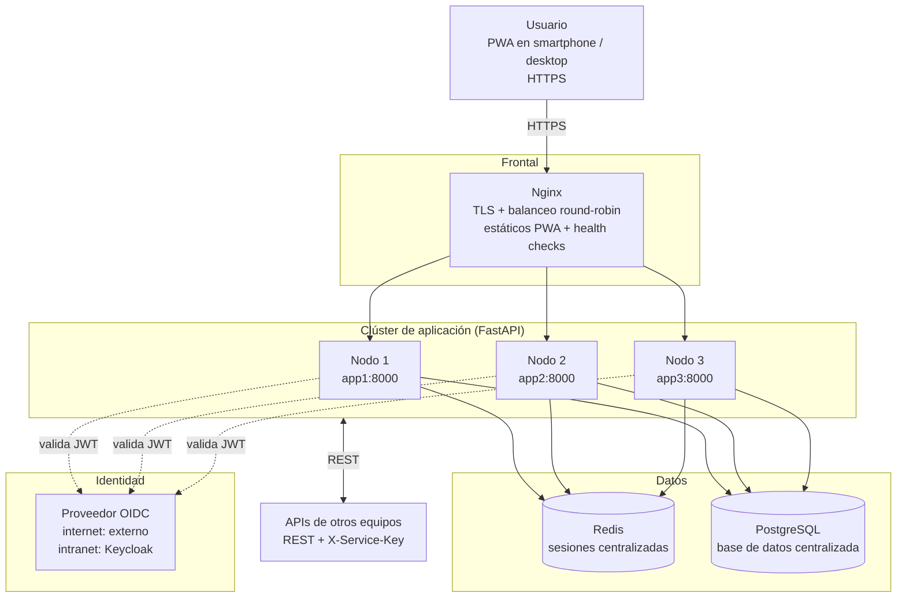
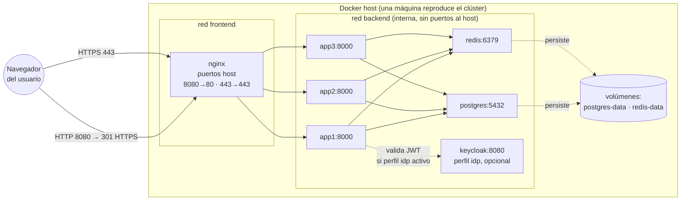

# Fase 0 — Arquitectura de referencia

> Convenciones de notación y simbología: `docs/convenciones.md`.
> Los diagramas se escriben en Mermaid (texto versionado en Git).

## Diagrama 1 — Vista lógica de la arquitectura

### Cómo leer el diagrama

| Símbolo | Significado en este diagrama |
|---|---|
| `[Texto]` rectángulo | Componente o actor: usuario, Nginx, nodos, IdP, sistemas externos |
| `[(Texto)]` cilindro | Almacén de datos: Redis y PostgreSQL |
| `subgraph` (caja con nombre) | Frontera de responsabilidad/despliegue |
| `-->` flecha sólida | Comunicación principal síncrona (HTTPS, SQL, protocolo Redis) |
| `-.->` flecha punteada | Interacción auxiliar o configurable (validación de JWT contra el IdP) |
| `-->|texto|` | Protocolo o propósito de la conexión |

### Descripción de componentes

| Componente | Tecnología | Responsabilidad |
|---|---|---|
| **Usuario** | Navegador con la PWA instalada | Cliente único del sistema; solo habla con Nginx por HTTPS |
| **Nginx** (servidor frontal) | nginx:alpine | Termina TLS, balancea a los 3 nodos (round-robin), sirve los estáticos de la PWA, health checks pasivos (`max_fails`) |
| **Nodos 1–3** | FastAPI + Uvicorn | Misma imagen, diferenciados por `NODE_ID`. Procesan `/api/v1/*`. Ninguno guarda estado local de sesión |
| **Redis** | redis:7-alpine | Almacén central de sesiones (cookie opaca + TTL). Hace posible que cualquier nodo atienda a cualquier usuario |
| **PostgreSQL** | postgres:16-alpine | Base de datos centralizada, única para los 3 nodos |
| **Proveedor OIDC** | externo / Keycloak | Emite y valida identidad. El backend valida JWT contra el `OIDC_ISSUER` configurado por entorno |
| **APIs de otros equipos** | REST + `X-Service-Key` | Integración entre sistemas: este sistema expone y consume APIs de otros grupos |

### Flujo de una petición

1. El usuario envía `https://<dominio>/api/v1/...` — llega a **Nginx** (único punto de entrada).
2. Nginx termina TLS y reenvía al siguiente nodo en rotación (round-robin).
3. El nodo lee la cookie de sesión, busca la sesión en **Redis** (no en memoria local) y accede a **PostgreSQL** si necesita datos de negocio.
4. Si la petición trae un JWT, el nodo lo valida contra el **IdP** configurado.
5. La respuesta vuelve por el mismo camino. La siguiente petición puede caer en **otro nodo** sin perder la sesión — demostrado con `/api/v1/session`.
6. Las llamadas a APIs de otros equipos salen del cluster con autenticación `X-Service-Key`, timeouts y reintentos.

## Diagrama 2 — Vista de despliegue (Docker Compose)

### Cómo leer el diagrama de despliegue

| Símbolo | Significado en este diagrama |
|---|---|
| `((Texto))` círculo doble | Actor externo al sistema desplegado |
| `subgraph` anidados | Límites físicos: host Docker → redes internas de Compose |
| `[nombre:puerto]` | Contenedor y puerto en el que escucha |
| `-->` flecha sólida | Tráfico de red entre contenedores |
| `-.->` flecha punteada | Persistencia en volúmenes o dependencia opcional (perfil `idp`) |

### Puntos clave de la vista de despliegue

- **Dos redes**: `frontend` (solo Nginx) y `backend` (apps, Redis, Postgres, Keycloak). Los nodos app **no exponen puertos al host** — solo son alcanzables vía Nginx.
- **Volúmenes**: `postgres-data` y `redis-data` persisten los datos entre reinicios del clúster.
- **Keycloak** solo levanta con `--profile idp` (modo intranet con IdP propio).
- El puerto HTTP del host es `8080` porque `80` suele estar reservado en Windows; redirige a HTTPS.

## Decisiones

- **Sin sticky sessions**: cualquier nodo atiende a cualquier usuario porque la
  sesión vive en Redis (cookie opaca `tpi115_session` + TTL configurable).
- **Nginx termina TLS** y sirve los estáticos de la PWA; `/api/*` se proxifica
  al upstream con `proxy_next_upstream` para reintentar en otro nodo si uno
  falla.
- **Puntos únicos de fallo aceptados** (alcance del proyecto): Redis y
  PostgreSQL. Mejora opcional documentada: Redis Sentinel / réplica de BD.
- **Configuración por entorno**: `.env` (`OIDC_ISSUER`, `DATABASE_URL`,
  `REDIS_URL`, `CDN_BASE_URL`, `CORS_ORIGINS`, credenciales) + override de
  compose (`docker-compose.internet.yml` / `docker-compose.intranet.yml`).
- **Advertencia PWA-intranet**: instalar la PWA en un celular exige HTTPS de
  confianza; con CA interna hay que instalar el certificado raíz en el
  dispositivo (ver `deploy/certs/README.md` y el manual de instalación).
