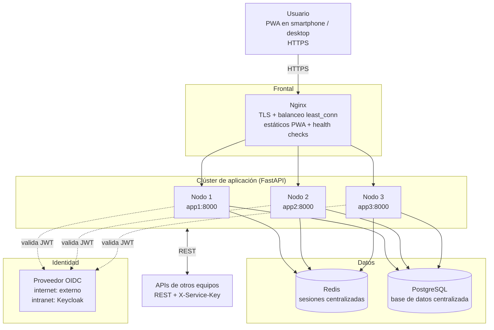

# Fase 0 — Arquitectura de referencia

## Decisiones

- **Sin sticky sessions**: cualquier nodo atiende a cualquier usuario porque la
  sesión vive en Redis (cookie opaca `tpi115_session` + TTL configurable).
- **Nginx termina TLS** y sirve los estáticos de la PWA; `/api/*` se proxifica
  al upstream con `least_conn` y `proxy_next_upstream` para reintentar en otro
  nodo si uno falla.
- **Puntos únicos de fallo aceptados** (alcance del proyecto): Redis y
  PostgreSQL. Mejora opcional documentada: Redis Sentinel / réplica de BD.
- **Configuración por entorno**: `.env` (`OIDC_ISSUER`, `DATABASE_URL`,
  `REDIS_URL`, `CDN_BASE_URL`, `CORS_ORIGINS`, credenciales) + override de
  compose (`docker-compose.internet.yml` / `docker-compose.intranet.yml`).
- **Advertencia PWA-intranet**: instalar la PWA en un celular exige HTTPS de
  confianza; con CA interna hay que instalar el certificado raíz en el
  dispositivo (ver `deploy/certs/README.md` y el manual de instalación).
